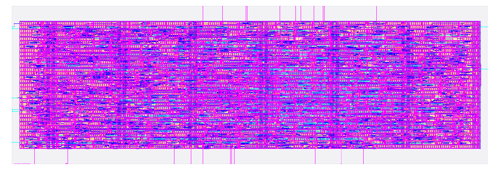
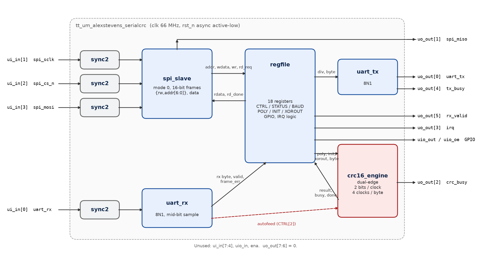
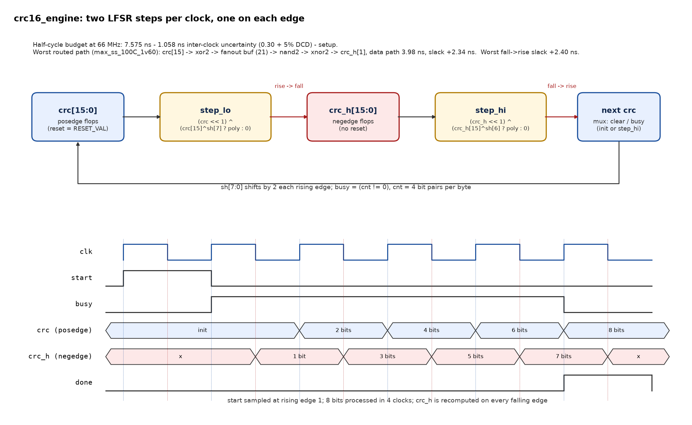

# sky130-serialcrc

[](https://github.com/alexnstevens06/sky130-serialcrc/actions/workflows/ci.yml)

**SerialCRC** (`tt_um_alexstevens_serialcrc`) is a small ASIC I designed from scratch in Verilog for the
SkyWater **SKY130** open PDK. It is an SPI-controlled serial peripheral: a register file in front of an
**8N1 UART** and a **programmable CRC-16 accelerator**. The CRC engine uses **both clock edges** to
process two bits per clock. The design is hardened with **LibreLane** into a TinyTapeout **1x2** tile and
closes timing at **66 MHz** across all nine PVT/RC corners. DRC, LVS and antenna checks are clean.


*Final routed layout (LibreLane run `de2`), 334.88 x 111.52 um, rendered with KLayout.*

## Highlights

| | |
|---|---|
| Function | SPI slave, register file, UART TX/RX, CRC-16 (any polynomial, init, xorout, reflection) |
| Clock | 66 MHz (15.15 ns); CRC uses rising and falling edges, 2 bits per clock |
| Process | SKY130A, `sky130_fd_sc_hd`, LibreLane v3.0.14 (Classic flow) |
| Die / core | 0.0373 mm^2 / 0.0291 mm^2 (TinyTapeout 1x2) |
| Std-cell area | 0.0189 mm^2, 65.0% core utilization |
| Worst setup / hold | +2.34 ns (half-cycle path, ss 100C 1.60V) / +0.038 ns |
| Sign-off | DRC 0 (Magic + KLayout), LVS clean, 0 antenna violations |
| Verification | 4 Verilog testbenches (5,976 checks) plus cocotb (SPI, UART baud edges, CRC-16 vs Python, reset), SymbiYosys, generic-cell gate-level sim, 95.7% line / 90.8% toggle coverage, Verilator lint clean |

## What it does

A microcontroller talks to the chip over SPI. Through 18 byte-wide registers it can:
- send and receive UART bytes at a programmable baud rate,
- compute CRC-16 over bytes it writes, or over every byte the UART receives (autofeed),
- drive 8 general-purpose outputs and get an interrupt on RX or CRC completion.

One CRC engine covers CRC-16/CCITT-FALSE, ARC, MODBUS, XMODEM, KERMIT, X-25 and the other Rocksoft-model
variants, because the polynomial, init value, final XOR and input/output reflection are all registers.

## Architecture



- **`sync2`**: two-flop synchronizers for the four asynchronous inputs (UART RX, SCLK, CS_n, MOSI).
- **`spi_slave`**: mode 0, oversampled by `clk` (f_sclk <= f_clk / 8). Each 16-bit frame is `{rw, addr[6:0]}`
  then data. Side effects only happen on the 16th bit, so raising CS early aborts cleanly.
- **`regfile`**: control/status, sticky flags with read-snapshot clear, IRQ, GPIO.
- **`uart_tx` / `uart_rx`**: 8N1. Each bit lasts divisor + 1 clocks. RX samples the center of the bit for even and odd divisors, rejects false starts,
  and detects framing errors with break recovery. The bit-timer terminal count is a registered flag, so the
  16-bit compare is off the critical path.
- **`crc16_engine`**: programmable LFSR, two steps per clock using both edges (below).

### Pins (TinyTapeout `tt_um_*` convention)

| Pin | Dir | Name | Description |
|-----|-----|------|-------------|
| `ui_in[0]` | in | `uart_rx` | UART receive, idle high |
| `ui_in[1]` | in | `spi_sclk` | SPI clock, mode 0, f_sclk <= f_clk / 8 |
| `ui_in[2]` | in | `spi_cs_n` | SPI chip select, active low |
| `ui_in[3]` | in | `spi_mosi` | SPI data in, MSB first |
| `uo_out[0]` | out | `uart_tx` | UART transmit, idle high |
| `uo_out[1]` | out | `spi_miso` | SPI data out (0 when CS high) |
| `uo_out[2]` | out | `crc_busy` | CRC engine is processing a byte |
| `uo_out[3]` | out | `irq` | `(irq_rx_en & rx_valid) \| (irq_crc_done_en & crc_done)` |
| `uo_out[4]` | out | `uart_tx_busy` | Transmitter busy |
| `uo_out[5]` | out | `uart_rx_valid` | Unread received byte |
| `uio_out` / `uio_oe` | out | `gpio` | GPIO_OUT / GPIO_OE registers |
| `clk`, `rst_n` | in | | 66 MHz clock, asynchronous active-low reset |

`ui_in[7:4]`, `uio_in` and `ena` are unused. `uo_out[7:6]` are 0.

### Register map

| Addr | Name | Access | Reset | Description |
|------|------|--------|-------|-------------|
| 0x00 | ID | R | 0xA5 | Chip ID |
| 0x01 | CTRL | RW | 0x00 | [0] refin, [1] refout, [2] rx_autofeed, [3] irq_rx_en, [4] irq_crc_done_en |
| 0x02 | STATUS | R | 0x00 | [0] tx_busy, [1] rx_valid, [2] crc_busy, [3] rx_overrun\*, [4] crc_done\*, [5] frame_err\* |
| 0x03/0x04 | BAUD_LO/HI | RW | 572 | Clocks per bit minus 1, including 0 (572 is 115200 baud at 66 MHz) |
| 0x05 | UART_DATA | RW | - | Write: transmit (ignored while busy). Read: pop the RX byte. A byte that arrives mid-read stays pending |
| 0x06/0x07 | POLY_LO/HI | RW | 0x1021 | CRC polynomial (normal form) |
| 0x08/0x09 | INIT_LO/HI | RW | 0xFFFF | CRC initial value |
| 0x0A/0x0B | XOROUT_LO/HI | RW | 0x0000 | CRC final XOR |
| 0x0C | CRC_DATA | W | - | Feed one byte (4 clocks) |
| 0x0D | CRC_CMD | W | - | bit0: load CRC with INIT |
| 0x0E/0x0F | CRC_LO/HI | R | 0xFFFF | Result (after refout and xorout) |
| 0x10 | GPIO_OUT | RW | 0x00 | Drives `uio_out` |
| 0x11 | GPIO_OE | RW | 0x00 | Drives `uio_oe` |

\* Sticky bits. Reading STATUS clears only the bits that were set in the returned value, so an event that
lands mid-read is not lost. Other addresses read 0x00. [`SPEC.md`](SPEC.md) has the full specification.

## Dual-edge CRC at 66 MHz



The CRC register `crc` is updated on the rising edge. A shadow register `crc_h` is updated on every falling
edge with one LFSR step of `crc` (input bit `sh[7]`). On the next rising edge, `crc` takes a second step from
`crc_h` (input bit `sh[6]`). A byte takes **4 clocks instead of 8**, and each half of the clock carries only
a single LFSR step.

Design decisions:
- **Timing against the half period.** `create_clock` has a 50% waveform, so rise->fall and fall->rise
  paths are checked against 7.575 ns.
- **Duty-cycle distortion margin.** Half-cycle paths get an extra 5% of the period (0.758 ns) of
  inter-clock uncertainty on top of the 0.30 ns clock uncertainty.
- **No reset on `crc_h`.** It is recomputed every falling edge and only read while busy. With a reset, the
  `rst_n` recovery check into the falling-edge flops was the one failing path (-0.40 ns). Removing it closed timing.
- **Registered UART done flags.** The single-edge critical path was the UART bit-timer compare (10.74 ns).
  It is now a flag computed one cycle ahead.
- **SPI and the register file stay rising-edge only.** A falling-edge synchronizer stage would halve
  metastability settling time for no throughput gain.

The worst half-cycle path at the slow corner leaves +2.34 ns on top of the 5% margin. That is roughly
(2.34 + 0.758) / 15.15, about 20%, of duty-cycle headroom.

## Verification

| Testbench | Scope | Checks |
|-----------|-------|--------|
| `tb_crc16` | 7 catalogue CRC-16 variants on `"123456789"`, 250 random poly/init/xorout/reflection/length cases against a byte-wise reference model, busy/done/clear/reset behavior | 4,439 |
| `tb_uart` | TX->RX loopback of all 256 bytes at divisors 4 and 0, divisors up to 0xFFFF, exact bit timing, start-while-busy, false-start glitch, framing error and break recovery, +/-3% baud mismatch, back-to-back frames, center sample point for even and odd divisors | 1,213 |
| `tb_top` | Chip pins only: SPI master model at the minimum 8:1 clock ratio, reset values and readback of every register, random register traffic against a shadow model, aborted SPI transfers, CRC presets over SPI, IRQs, overrun (including mid-read), framing error, UART->CRC streaming, 1 clock/bit RX, UART byte that arrives during a UART_DATA read, SCLK high or low at reset release with CS low | 185 |
| `tb_dualedge` | CRC presets and UART loopback at 30%, 50% and 70% clock duty cycle; checks that `crc_h` changes only on falling edges and `crc` only on rising edges; 4 clocks per byte | 139 |

- **Coverage.** Verilator line/branch and toggle coverage over all testbenches, `rtl/` only, from CI
  (Verilator 5.020): **95.7% line, 90.8% toggle**. `crc16_engine`, `regfile`, `spi_slave`, `sync2` and
  `uart_tx` reach 100% line coverage. The gaps are in `uart_rx` (unreachable `default:` arm, unit-level-only
  paths) and toggles on unused TinyTapeout inputs and the upper baud-counter bits.
- **Cocotb (Icarus).** `tb/cocotb/` drives the chip pins and the UART, CRC, and register-file
  modules directly. It covers SPI read/write and aborted frames, UART framing at 1 clock/bit
  through the wide divisors, +/-3% baud tolerance, CRC-16 against an independent Python model
  (catalogue values plus random polynomials), and reset in the middle of TX, RX, and SPI.
- **Formal.** SymbiYosys checks three properties. CRC-16 matches a byte-wise Rocksoft model for every
  input sequence in a 16-step BMC bound (`done` is reachable at step 14). The UART RX state register
  stays inside `IDLE`..`BREAK` (k-induction), so the `default` arm is unreachable. The register file's
  read/write storage matches an independent shadow, including the read port and the TX/CRC strobes
  (k-induction). `make formal`.
- **Generic-cell gate-level simulation.** `make gls` synthesizes with Yosys to internal gates
  (`$_AND_`, `$_DFF_*`, ...) and runs `tb_top` on that netlist with Icarus and `simcells.v`. No PDK
  and no place-and-route. The clock and baud parameters match `tb_top` (reset divisor 86).
- **Routed gate-level simulation.** `scripts/gls.sh` runs `tb_top` on the routed netlist with the sky130
  functional cell models at 50%, 30% and 70% clock duty. The signed-off run was 178 checks, before the
  divisor-0 and mid-read fixes (the testbench is now 185 checks). This is functional, unit-delay
  simulation; timing is signed off by static timing analysis.
- **Lint.** `verilator --lint-only -Wall` gives 0 warnings (also run in CI).
- **Mutation check** (on the original single-edge RTL). Of five hand-injected bugs, all four that change
  behavior make at least one testbench fail. The fifth is logically equivalent.

## Physical results

LibreLane v3.0.14, SKY130A, `sky130_fd_sc_hd`, constraints in [`librelane/serialcrc.sdc`](librelane/serialcrc.sdc).
Full report: [`docs/pnr-results.md`](docs/pnr-results.md).

| Metric | Value |
|---|---|
| Die area | 334.88 x 111.52 um = 37,346 um^2 (0.0373 mm^2) |
| Core area | 29,068 um^2 (0.0291 mm^2) |
| Std-cell area (excluding fill/decap) | 18,882 um^2 (0.0189 mm^2) |
| Core utilization | 65.0% (2,546 cells; 266 flops, 16 of them on the falling edge) |
| Routing / Magic / KLayout DRC | 0 / 0 / 0 |
| LVS | Clean |
| Antenna | 0 violating nets / pins |
| Max slew / cap violations | 0 / 0 |

**Per-corner slack (ns).** "All" is the sign-off STA worst slack. The half-cycle columns are rise->fall (R->F)
and fall->rise (F->R) register paths.

| Corner | Setup (all) | Hold (all) | Setup R->F | Setup F->R | Clock skew |
|---|---|---|---|---|---|
| min_ff_n40C_1v95 | 5.255 | 0.174 | 5.27 | 5.25 | 0.343 |
| nom_ff_n40C_1v95 | 5.229 | 0.176 | 5.24 | 5.23 | 0.343 |
| max_ff_n40C_1v95 | 5.207 | 0.179 | 5.21 | 5.21 | 0.344 |
| min_tt_025C_1v80 | 4.435 | 0.176 | 4.52 | 4.43 | 0.366 |
| nom_tt_025C_1v80 | 4.398 | 0.164 | 4.48 | 4.40 | 0.365 |
| max_tt_025C_1v80 | 4.369 | 0.152 | 4.43 | 4.37 | 0.366 |
| min_ss_100C_1v60 | 2.491 | 0.073 | 2.49 | 2.52 | 0.423 |
| nom_ss_100C_1v60 | 2.411 | 0.055 | 2.41 | 2.45 | 0.421 |
| max_ss_100C_1v60 | 2.337 | 0.038 | 2.34 | 2.40 | 0.421 |

**Critical path** (max_ss_100C_1v60, rise->fall): `u_crc.crc[15]` -> `xor2` -> fanout buffer (21 loads) ->
`nand2` -> `xnor2` -> `u_crc.crc_h[1]`. The data path is 3.98 ns, and slack is +2.34 ns.

**Area by block** (Yosys hierarchical synthesis before place-and-route, tt corner):

| Block | Cells | Area (um^2) |
|---|---|---|
| regfile | 330 | 4,544 |
| crc16_engine | 231 | 2,268 |
| uart_rx | 208 | 2,079 |
| spi_slave | 122 | 1,588 |
| uart_tx | 156 | 1,515 |
| sync2 x 4 | 8 | 205 |
| **Total** | **1,055** | **12,200** |

## How to build and run

Requirements: `iverilog` (>= 12), `verilator` (>= 5.020), `yosys`, `python3`, `make`, and cocotb
(`pip install -r tb/cocotb/requirements.txt`). `make formal` needs SymbiYosys (`sby`) and a bitvector
solver (`bitwuzla`). `make gls` needs Yosys's `simcells.v` (`yosys-config --datdir`). Both come with
[OSS CAD Suite](https://github.com/YosysHQ/oss-cad-suite-build). For hardening you also need Docker
and the sky130A PDK, installed with [ciel](https://github.com/fossi-foundation/ciel).

```sh
make lint        # verilator --lint-only -Wall
make test        # Icarus testbenches + cocotb (SPI, UART, CRC, reset)
make coverage    # Verilog testbenches under Verilator with line+toggle coverage
make synth       # Yosys -> sky130_fd_sc_hd, area report in build/synth/
make formal      # SymbiYosys: CRC BMC, UART FSM, register-file prove
make gls         # generic-cell netlist + Icarus tb_top (no PDK)

scripts/harden.sh my_run                  # LibreLane in Docker (nice, 4 CPUs) -> librelane/runs/my_run/
scripts/gls.sh librelane/runs/my_run      # gate-level sim of the routed netlist at 30/50/70% duty
```

`scripts/half_cycle_sta.tcl` reports the rise->fall and fall->rise paths for one corner with OpenSTA.
`scripts/diagrams.py` and `scripts/render_layout.py` regenerate the images in `docs/img/`.

## Repository layout

```
rtl/        synthesizable Verilog-2005 (7 modules)
tb/         Verilog testbenches and cocotb suites
formal/     SymbiYosys properties (CRC, UART FSM, register file)
librelane/  LibreLane config and SDC constraints (run outputs are gitignored)
synth/      Yosys scripts (sky130 liberty map, and generic cells for GLS)
scripts/    hardening, routed gate-level sim, STA, coverage/synthesis summaries, diagrams
docs/       PnR results, TinyTapeout datasheet page, images
info.yaml   TinyTapeout project metadata (1x2 tile)
```

## CI

GitHub Actions ([`.github/workflows/ci.yml`](.github/workflows/ci.yml)) runs lint, the Verilog
testbenches, the cocotb suites (Icarus), and coverage, plus a Yosys synthesis job that posts an area
summary. Two more jobs run the SymbiYosys proofs and the generic-cell gate-level simulation.

## License

[MIT](LICENSE) (c) 2026 Alex Stevens
