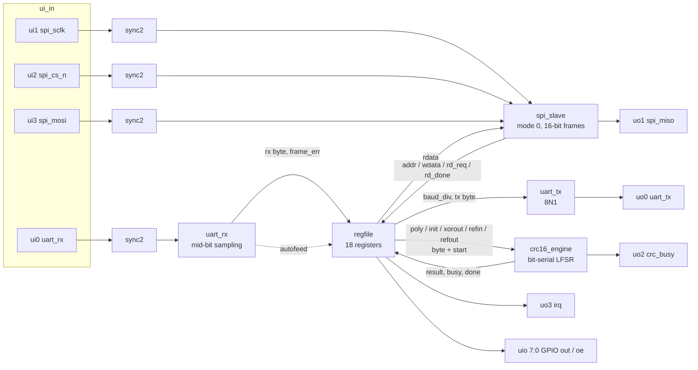

# sky130-serialcrc

[](https://github.com/alexnstevens06/sky130-serialcrc/actions/workflows/ci.yml)

**SerialCRC** (`tt_um_alexstevens_serialcrc`) is a small ASIC I wrote from scratch in Verilog for the
SkyWater **SKY130** open PDK. It is an SPI-controlled serial peripheral: a register file in front
of an **8N1 UART** and a **programmable CRC-16 accelerator**. Bytes received on the UART can
optionally stream straight into the CRC. It uses the [TinyTapeout](https://tinytapeout.com) top-level
pinout, so it can go on a shuttle with no changes.

Everything here runs on free, open-source tools: Icarus Verilog, Verilator, and Yosys.

## Why this design

I wanted a project that is small enough to finish and verify properly, but that still shows the
skills a real chip block needs:

- **Clock-domain crossing and protocol work.** SPI and UART inputs are asynchronous to the
  system clock, so they pass through synchronizers and are oversampled. The SPI slave has to
  meet MISO timing with only 8 clocks per SCLK period.
- **A real datapath accelerator.** The CRC engine is a programmable bit-serial LFSR in the
  Rocksoft model (any 16-bit polynomial, init, final XOR, in/out reflection). One engine covers
  CRC-16/CCITT-FALSE, ARC, MODBUS, XMODEM, KERMIT, X-25, DNP and more.
- **Verification.** There are three self-checking testbenches: catalogue check values, a
  reference model, randomized stimulus, and protocol corner cases. They are measured with
  Verilator line/toggle coverage and sanity-checked with hand-made RTL mutations.
- **Fitting TinyTapeout.** The design is about 1k standard cells, which is the size of a
  1x1/1x2 TinyTapeout tile. It is useful on its own, since it bridges a microcontroller's SPI to
  a UART and validates packets.

I chose this over an 8-bit CPU because a peripheral with a precise spec gives an unambiguous
pass/fail for every feature, and the CRC check values give an external ground truth.

## Block diagram



## Interface

### Pins (TinyTapeout `tt_um_*` convention)

| Pin | Dir | Name | Description |
|-----|-----|------|-------------|
| `ui_in[0]` | in | `uart_rx` | UART receive, idle high (synchronized) |
| `ui_in[1]` | in | `spi_sclk` | SPI clock, mode 0, f_sclk <= f_clk / 8 |
| `ui_in[2]` | in | `spi_cs_n` | SPI chip select, active low |
| `ui_in[3]` | in | `spi_mosi` | SPI data in, MSB first |
| `ui_in[7:4]` | in | - | unused |
| `uo_out[0]` | out | `uart_tx` | UART transmit, idle high |
| `uo_out[1]` | out | `spi_miso` | SPI data out (0 when CS high) |
| `uo_out[2]` | out | `crc_busy` | CRC engine is processing a byte |
| `uo_out[3]` | out | `irq` | `(irq_rx_en & rx_valid) \| (irq_crc_done_en & crc_done)` |
| `uo_out[4]` | out | `uart_tx_busy` | Transmitter busy |
| `uo_out[5]` | out | `uart_rx_valid` | Unread received byte |
| `uo_out[7:6]` | out | - | 0 |
| `uio_out[7:0]` / `uio_oe[7:0]` | out | `gpio` | GPIO_OUT / GPIO_OE registers |
| `clk`, `rst_n`, `ena` | in | - | 10 MHz nominal clock, async active-low reset |

### SPI protocol

Each transaction is 16 SCLK cycles with CS low: `{rw, addr[6:0]}` then `data[7:0]`, MSB first.
`rw=1` reads. The register value comes out on MISO during the second byte. Writes and read side
effects only happen when the 16th bit completes, so raising CS early aborts cleanly.

### Register map

| Addr | Name | Access | Reset | Description |
|------|------|--------|-------|-------------|
| 0x00 | ID | R | 0xA5 | Chip ID |
| 0x01 | CTRL | RW | 0x00 | [0] refin, [1] refout, [2] rx_autofeed, [3] irq_rx_en, [4] irq_crc_done_en |
| 0x02 | STATUS | R | 0x00 | [0] tx_busy, [1] rx_valid, [2] crc_busy, [3] rx_overrun\*, [4] crc_done\*, [5] frame_err\* |
| 0x03/0x04 | BAUD_LO/HI | RW | 86 | Clocks per bit minus 1 (86 gives 115200 baud at 10 MHz) |
| 0x05 | UART_DATA | RW | - | Write: transmit (ignored while busy). Read: pop RX byte |
| 0x06/0x07 | POLY_LO/HI | RW | 0x1021 | CRC polynomial (normal form) |
| 0x08/0x09 | INIT_LO/HI | RW | 0xFFFF | CRC initial value |
| 0x0A/0x0B | XOROUT_LO/HI | RW | 0x0000 | CRC final XOR |
| 0x0C | CRC_DATA | W | - | Feed one byte (8 clocks) |
| 0x0D | CRC_CMD | W | - | bit0: load CRC with INIT |
| 0x0E/0x0F | CRC_LO/HI | R | 0xFFFF | Result (after refout and xorout) |
| 0x10 | GPIO_OUT | RW | 0x00 | Drives `uio_out` |
| 0x11 | GPIO_OE | RW | 0x00 | Drives `uio_oe` |

\* Sticky bits. Reading STATUS clears them, but only bits that were set in the value returned,
so an event that lands mid-read is not lost. [`SPEC.md`](SPEC.md) has the full specification.

## Repository layout

```
rtl/        synthesizable Verilog-2005 (7 modules)
tb/         self-checking testbenches (Icarus + Verilator)
synth/      Yosys script for sky130_fd_sc_hd
scripts/    coverage and synthesis report summarizers
docs/       TinyTapeout datasheet page
info.yaml   TinyTapeout project metadata
```

## How to run

Requirements: `iverilog` (>= 12), `verilator` (>= 5.020), `yosys` (tested with 0.69 from
[OSS CAD Suite](https://github.com/YosysHQ/oss-cad-suite-build)), `python3`, `make`.

```sh
make lint        # verilator --lint-only -Wall
make test        # 3 self-checking testbenches under Icarus Verilog
make coverage    # same testbenches under Verilator with line+toggle coverage
make fetch-lib   # (once) download sky130_fd_sc_hd__tt_025C_1v80.lib if no PDK is installed
make synth       # Yosys -> sky130_fd_sc_hd cells, area report in build/synth/
```

`make synth` looks for the liberty file in `$SKY130_LIB`, then
`$PDK_ROOT/sky130A/libs.ref/sky130_fd_sc_hd/lib/`, then `build/lib/` (from `make fetch-lib`).

## Results

### Verification

| Testbench | Scope | Checks |
|-----------|-------|--------|
| `tb_crc16` | 7 catalogue CRC-16 variants on `"123456789"`, 250 random poly/init/xorout/reflection/length cases against a byte-wise reference model, busy/done/clear/reset behaviour | 4,439 |
| `tb_uart` | TX->RX loopback of all 256 bytes, divisors 4 to 0xFFFF, exact bit timing, start-while-busy, false start glitch, framing error + break recovery, +/-3% baud mismatch, back-to-back frames | 689 |
| `tb_top` | Chip pins only: SPI master model at the minimum 8:1 clock ratio, every register's reset value and readback, random register traffic against a shadow model, unmapped/read-only addresses, aborted SPI transfers, CRC presets over SPI, IRQs, UART TX/RX models, overrun (including mid-read), framing error, pin loopback, UART->CRC streaming (CRC-16/MODBUS) | 177 |

All tests pass under both Icarus Verilog and Verilator.

**Coverage** (Verilator, merged over all testbenches, `rtl/` only):

| File | Line | Points (line+toggle+branch) |
|------|------|------------------------------|
| crc16_engine.v | 100% | 99.8% |
| regfile.v | 100% | 99.3% |
| spi_slave.v | 100% | 100% |
| sync2.v | 100% | 100% |
| tt_um_alexstevens_serialcrc.v | 94.7% | 92.4% |
| uart_rx.v | 98.0% | 90.8% |
| uart_tx.v | 100% | 93.8% |
| **Total** | **99.4%** (314/316) | **96.4%** (2205/2288) |

The remaining gaps are the unreachable `default:` FSM arm, the unused TinyTapeout inputs
(`uio_in`, `ui_in[7:4]`, `ena`), and constant outputs.

**Mutation check:** I injected five hand-made RTL bugs (overrun never set, SPI MISO off by one
bit, UART RX sampling at bit edge instead of mid-bit, sticky bit cleared without the read
snapshot, CRC start not gated by busy). All four that change behaviour make at least one
testbench fail. The fifth is logically equivalent (the engine already ignores starts while
busy).

### Synthesis (Yosys 0.69, sky130_fd_sc_hd, tt_025C_1v80)

| Metric | Value |
|--------|-------|
| Standard cells | 991 |
| Flip-flops | 249 (196 `dfrtp`, 53 `dfstp`) |
| Cell area | 11,540 um^2 (55% sequential) |
| TinyTapeout 1x1 tile (~17,955 um^2) | 64% cell utilization |

At 64% the design is above the ~60% density that TinyTapeout's flow usually places
comfortably, so `info.yaml` asks for a **1x2** tile. Area numbers are from synthesis and come
before placement, resizing, and buffering.

## CI

GitHub Actions ([`.github/workflows/ci.yml`](.github/workflows/ci.yml)):

- **lint-test**: Ubuntu 24.04 with apt `iverilog` + `verilator`, runs `make lint test coverage`
  and uploads logs and annotated coverage.
- **synth**: OSS CAD Suite, fetches the liberty file, runs `make synth`, and posts the area
  summary.

## Next steps

- **Harden with OpenLane 2 / LibreLane** (sky130A, `sky130_fd_sc_hd`): floorplan into the
  TinyTapeout tile, place-and-route, then DRC/LVS with Magic and Netgen, and timing sign-off with
  OpenSTA at 10 MHz across corners.
- **Fit a 1x1 tile:** replace the 16-bit XOROUT register with a 1-bit "invert" flag (every
  common CRC-16 uses 0x0000 or 0xFFFF), narrow the baud counter, and share the TX/RX counters.
- **TinyTapeout submission:** move `rtl/` into the template's `src/`, add a cocotb `test/` for
  the TT gate-level test, and run the TT GDS GitHub Action.
- Formal properties (SymbiYosys) for the SPI framing and the CRC/LFSR equivalence.
- An RX FIFO and a CRC-32 mode.

## License

[MIT](LICENSE) (c) 2026 Alex Stevens
